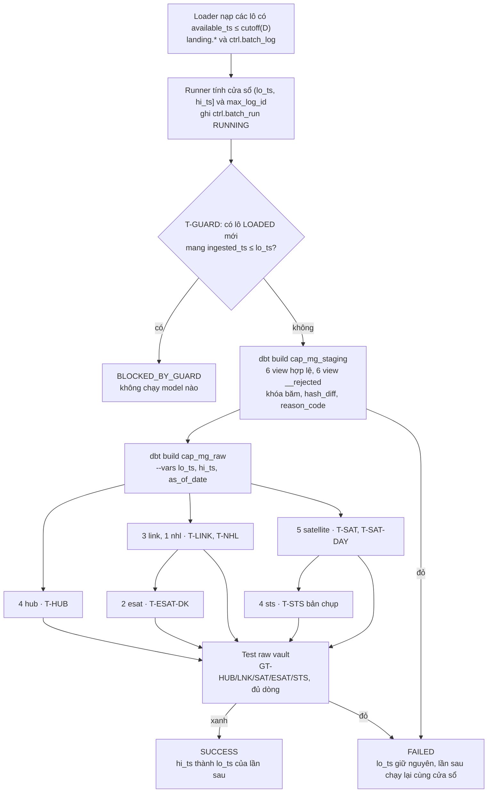
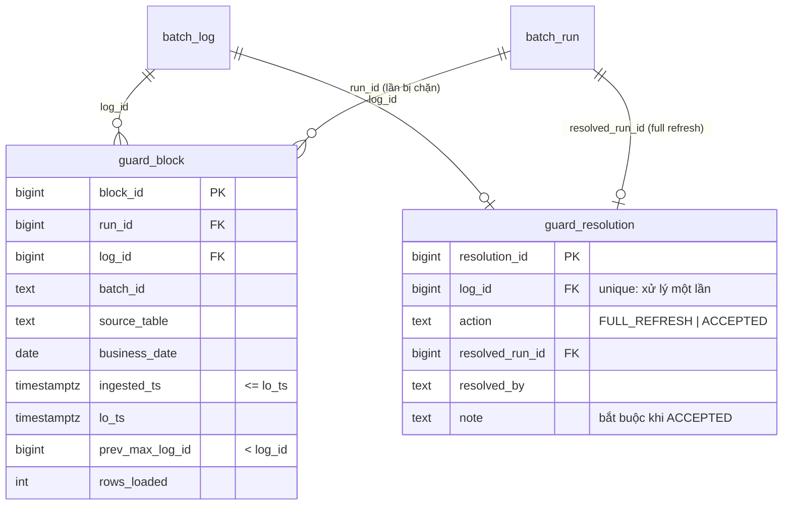

# Sổ kỹ thuật tầng Raw Vault — CAP-MG

- **Đề:** `CAP-MG` (môi giới, đơn vị và chăm sóc), `FNV-CAP-DBT v1.5`
- **Ngày lập:** 02/11/2026
- **Phạm vi:** `finova-dbt/models/atomic/raw/` (19 bảng), macro mẫu nạp `finova-dbt/macros/raw/dv_load.sql`, runner `runner/run.py`, test raw vault. Quyết định nghiệp vụ `DEC-CAP-MG-*` vẫn ở `docs/decisions.md`; landing và staging ở `docs/ky_thuat_landing_staging.md`.

## Cách đọc

Mỗi mục `RV-xx` gồm: vấn đề, cách làm, vì sao chọn (các phương án đã cân nhắc), bằng chứng. Số liệu lấy trên database thử `cap_mg_phucnd_ptfull`: bootstrap và ctrl dựng mới, runner chạy 19 ngày giao dịch từ 17/04 tới 15/05/2026.

## Danh mục bảng

| Bảng | Mẫu | Grain | Nguồn staging | Số dòng (dữ liệu đề) |
|---|---|---|---|---|
| `hub_broker` | T-HUB | mã môi giới FLEX | broker, reaflnk, events, kpi | 24 |
| `hub_account` | T-HUB | AFACCTNO | reaflnk, nav, events | 200 |
| `hub_regrp` | T-HUB | GRPID | regrp (grpid, parentid), broker (grpid) | 12 |
| `hub_reaflnk` | T-HUB | REAFLNK.AUTOID | reaflnk | 235 |
| `link_broker_regrp` | T-LINK | (môi giới, nhóm) | broker | 24 |
| `link_regrp_parent` | T-LINK | (đơn vị, cha) | regrp | 11 |
| `link_reaflnk` | T-LINK | (phân công, môi giới, tiểu khoản) | reaflnk | 235 |
| `nhl_broker_event` | T-NHL | event_id | events | 634 |
| `sat_broker_profile__flex` | T-SAT | (broker_hk, ingested_ts) | broker | 26 |
| `sat_regrp__flex` | T-SAT | (regrp_hk, ingested_ts) | regrp | 13 |
| `sat_reaflnk__flex` | T-SAT | (reaflnk_hk, ingested_ts) | reaflnk | 270 |
| `sat_broker_kpi__manual` | T-SAT | (broker_hk, ingested_ts) | kpi | 38 |
| `sat_account_nav_daily__flex` | T-SAT-DAY | (account_hk, business_date, ingested_ts) | nav | 3.800 |
| `esat_regrp_parent__flex` | T-ESAT-DK | (link_regrp_parent_hk, ingested_ts) | regrp, driving key regrp_hk | 12 |
| `esat_broker_regrp__flex` | T-ESAT-DK | (link_broker_regrp_hk, ingested_ts) | broker, driving key broker_hk | 24 |
| `sts_regrp__flex` | T-STS bản chụp | (regrp_hk, ingested_ts) | regrp ∪ regrp__rejected | 1 |
| `sts_broker__flex` | T-STS bản chụp | (broker_hk, ingested_ts) | broker ∪ rejected | 0 |
| `sts_reaflnk__flex` | T-STS bản chụp | (reaflnk_hk, ingested_ts) | reaflnk ∪ rejected | 0 |
| `sts_broker_kpi__manual` | T-STS bản chụp | (broker_hk, ingested_ts) | kpi ∪ rejected | 0 |

Hub chỉ có `<hk>, bkcc, <bk>, ingested_ts, event_ts, record_source` (Q3). Link chỉ có khóa băm của link và của hub, cùng cột hệ thống. Satellite có `hash_diff` và thuộc tính lấy nguyên tên từ staging. Mỗi model gọi đúng một macro.

## Sơ đồ quan hệ

Mũi tên đi từ bảng con tới bảng cha mà nó tham chiếu; nhãn là cột khóa dùng để nối. Mỗi mũi tên là một test `relationships` (GT-LNK-PARENT, GT-SAT-PARENT, GT-HUB-BKCC). Con số sau tên bảng là số dòng trên dữ liệu đề.

```mermaid
flowchart BT
    classDef hub fill:#dbeafe,stroke:#1d4ed8,color:#111
    classDef link fill:#dcfce7,stroke:#15803d,color:#111
    classDef sat fill:#fef9c3,stroke:#a16207,color:#111
    classDef esat fill:#ffedd5,stroke:#c2410c,color:#111
    classDef sts fill:#fee2e2,stroke:#b91c1c,color:#111
    classDef seed fill:#f3f4f6,stroke:#6b7280,color:#111

    REF[("ref_bkcc<br/>FLEX, FINOVA_APP")]:::seed

    HR["hub_regrp<br/>GRPID · 12"]:::hub
    HB["hub_broker<br/>mã môi giới · 24"]:::hub
    HA["hub_account<br/>AFACCTNO · 200"]:::hub
    HF["hub_reaflnk<br/>AUTOID · 235"]:::hub

    LRP["link_regrp_parent<br/>đơn vị → cha · 11"]:::link
    LBR["link_broker_regrp<br/>môi giới thuộc nhóm · 24"]:::link
    LRF["link_reaflnk<br/>phân công · 235"]:::link
    NHL["nhl_broker_event<br/>sự kiện app · 634"]:::link

    SR["sat_regrp__flex · 13"]:::sat
    SBP["sat_broker_profile__flex · 26"]:::sat
    SBK["sat_broker_kpi__manual · 38"]:::sat
    SRF["sat_reaflnk__flex · 270"]:::sat
    SNAV["sat_account_nav_daily__flex · 3.800"]:::sat

    ERP["esat_regrp_parent__flex · 12"]:::esat
    EBR["esat_broker_regrp__flex · 24"]:::esat

    TR["sts_regrp__flex · 1"]:::sts
    TB["sts_broker__flex · 0"]:::sts
    TK["sts_broker_kpi__manual · 0"]:::sts
    TF["sts_reaflnk__flex · 0"]:::sts

    HR & HB & HA & HF -.->|bkcc| REF

    LRP -->|regrp_hk| HR
    LRP -->|parent_regrp_hk| HR
    LBR -->|regrp_hk| HR
    LBR -->|broker_hk| HB
    LRF -->|reaflnk_hk| HF
    LRF -->|broker_hk| HB
    LRF -->|account_hk| HA
    NHL -->|broker_hk| HB
    NHL -->|account_hk| HA

    SR & TR -->|regrp_hk| HR
    SBP & SBK & TB & TK -->|broker_hk| HB
    SRF & TF -->|reaflnk_hk| HF
    SNAV -->|account_hk| HA

    ERP -->|link_regrp_parent_hk| LRP
    EBR -->|link_broker_regrp_hk| LBR
```

Vai trò của từng loại bảng:

| Loại | Lưu gì | Khi nào thêm dòng |
|---|---|---|
| Hub | Một dòng cho mỗi khóa nghiệp vụ: môi giới, đơn vị, tiểu khoản, phân công | Lần đầu gặp khóa ở bất kỳ staging nào mang khóa đó |
| Link | Một dòng cho mỗi tổ hợp khóa: đơn vị - cha, môi giới - nhóm, phân công - môi giới - tiểu khoản | Lần đầu gặp tổ hợp; không bao giờ đóng |
| Nhl | Sự kiện bất biến của app, thuộc tính nằm ngay trên link | Lần đầu gặp `event_id` |
| Satellite | Lịch sử thuộc tính mô tả của hub cha | `hash_diff` khác phiên bản liền trước (A → B → A ra 3 dòng) |
| Esat | Link nào đang hiệu lực, theo driving key (mỗi đơn vị một cha, mỗi môi giới một nhóm) | Driving key chuyển sang link khác: một dòng đóng link cũ, một dòng mở link mới |
| Sts | Khóa còn hay đã biến khỏi bản chụp đầy đủ | Trạng thái ACTIVE/DELETED đổi |

Business Vault đọc theo nhóm. Ví dụ, cây đơn vị tại ngày D dùng bốn bảng: cạnh lấy từ `link_regrp_parent`; esat chọn cạnh hiệu lực; sts bỏ đơn vị DELETED; satellite cho thuộc tính.

## Luồng nạp

Một lần chạy của runner cho ngày giao dịch D:

Các bước:
1. **Landing.** `load_manifest_batches(cutoff_ts)` nạp các lô chưa nạp có `available_ts ≤ cutoff(D)` (00:00 ngày D+1 giờ Việt Nam). Mỗi lô được ghi `ctrl.batch_log` với `ingested_ts` của lô.
2. **Cửa sổ.**
   - `lo_ts` là `hi_ts` của lần SUCCESS gần nhất; chưa có lần SUCCESS nào thì là `-infinity`.
   - `hi_ts` là `max(ingested_ts)` của các lô LOADED có `log_id ≤ max_log_id`. `max_log_id` là `log_id` lớn nhất của sổ lúc bắt đầu chạy; lô về giữa lúc chạy để lần sau.
   - Cửa sổ được truyền vào dbt dạng chữ ISO-8601 UTC (RV-08).
3. **T-GUARD.** Lô LOADED có `log_id` lớn hơn `max_log_id` của lần SUCCESS trước mà mang `ingested_ts ≤ lo_ts` là lô về muộn mang giờ cũ. Nếu nạp tiếp, phiên bản đầu ghi trong vault sẽ sai. Khi gặp lô như vậy runner dừng; người vận hành quyết định có full refresh hay không.
4. **Staging.** Các view tính lại trên toàn bộ landing. Mỗi dòng có khóa băm cho mọi hub và link nó mang, `hash_diff` của satellite, và dòng không dùng được nằm ở `__rejected` kèm `reason_code`.
5. **Raw vault.** Mỗi model chỉ đọc staging trong cửa sổ (`dv_window()`) và chỉ đọc chính nó (`{{ this }}`) khi chạy incremental. dbt chạy theo phụ thuộc:
   - hub, link, nhl, satellite đọc thẳng staging;
   - esat đọc thêm link đích, để biết link nào của driving key đang hiệu lực;
   - sts đọc thêm satellite, để biết khóa nào đã vào vault.

   `dbt build` chạy test của mỗi model ngay sau model đó; test đỏ thì các model phía sau bị bỏ qua.
6. **Ghi sổ.** Mọi bước xanh thì ghi SUCCESS, và `hi_ts` thành `lo_ts` của lần sau. Có bước đỏ thì ghi FAILED kèm `error_msg`; lần sau chạy lại đúng cửa sổ đó. Việc chạy lại an toàn nhờ PT-IDEMP (RV-02).

Mỗi mẫu nạp xử lý các dòng staging trong cửa sổ như sau:

| Mẫu | Các bước |
|---|---|
| T-HUB | Gộp khóa từ mọi staging mang khóa, bỏ khóa NULL → mỗi `hk` giữ dòng thấy sớm nhất (`ingested_ts`, rồi `record_source`) → chỉ chèn `hk` chưa có trong bảng |
| T-LINK | Như T-HUB, trên `link_hk`; dòng chỉ mang khóa băm của các hub |
| T-NHL | Như T-LINK, kèm thuộc tính sự kiện và `hash_diff`. Không so nội dung; xung đột nội dung do GT-NHL-CONTENT ở staging chặn |
| T-SAT | Bỏ dòng trùng `(khóa, ingested_ts, hash_diff)` → so `hash_diff` với dòng liền trước trong cửa sổ (`lag`); dòng đầu cửa sổ so với phiên bản trong vault ngay trước nó → giữ dòng khác → bỏ `(khóa, ingested_ts)` đã có |
| T-SAT-DAY | Như T-SAT, nhưng khóa so sánh gồm cả `business_date` (`tx_date` của NAV) |
| T-ESAT-DK | Mỗi `(driving key, ingested_ts)` một link → so link với lần trước (`lag`, hoặc link hiệu lực trong vault) → đổi link thì ghi `is_active = false` cho link cũ và `true` cho link mới, cùng `ingested_ts` |
| T-STS | Lô = các `ingested_ts` của view hợp lệ ∪ `__rejected` → khóa có mặt nếu có dòng ở một trong hai view → xét mọi khóa đã có trong satellite tính tới lô đó → chỉ ghi khi trạng thái khác lần trước (mặc định ACTIVE) |

Ví dụ: lô `CAP-MG-0051` (04/05), G4 chuyển từ CN2 sang CN1.

| Bảng | Kết quả | Lý do |
|---|---|---|
| staging `stg_flex__regrp` | Dòng G4 mang `link_regrp_parent_hk` (G4, CN1) và `sat_regrp_hd` mới | `parentid` đổi |
| `hub_regrp` | 0 dòng | G4, CN1 đã có từ 17/04 |
| `link_regrp_parent` | 1 dòng (G4, CN1) | Tổ hợp mới |
| `sat_regrp__flex` | 1 phiên bản G4 | `hash_diff` khác phiên bản trước |
| `esat_regrp_parent__flex` | 2 dòng cùng `ingested_ts`: (G4, CN2) false, (G4, CN1) true | Driving key G4 đổi link (PT-ESAT-SWITCH) |
| `sts_regrp__flex` | 0 dòng | G4 vẫn có mặt, trạng thái không đổi |

## Bảng tổng hợp

| Mã | Mức | Vấn đề | Trạng thái |
|---|---|---|---|
| RV-01 | Chặn | Staging thiếu `bkcc_<vai>`, `bk_<vai>` và khóa link cho vault | Đã sửa |
| RV-02 | Cao | SQL mẫu T-SAT/T-ESAT/T-STS không idempotent khi chạy lại cửa sổ | Đã sửa, có unit test |
| RV-03 | Cao | Khóa vắng khỏi bản chụp đầy đủ: ghi nhận "đã xóa" thế nào | `sts_*`, thay DEC-MG-D4 |
| RV-04 | Trung bình | Mô hình phân công và cây đơn vị | Hub phân công + link; esat cho cây và môi giới - nhóm |
| RV-05 | Cao | Loader bỏ qua bản chụp quay về nội dung cũ (A → B → A) | Đã sửa loader (KT-22), có test |
| RV-06 | Trung bình | `dv_window()` báo lỗi lúc parse, làm hỏng `dbt ls`, `dbt seed` | Đã sửa |
| RV-07 | Trung bình | `ref()` trong khối `is_incremental()` | Đã sửa |
| RV-08 | Trung bình | Runner: cửa sổ, T-GUARD, unit test, kỳ chạy | Đã làm |
| RV-09 | Thấp | Selector staging kéo theo test raw đọc cả hai tầng | Đã sửa |
| RV-10 | Cao | T-GUARD chỉ ghi `BLOCKED_BY_GUARD`, người vận hành không biết lô nào bị chặn, xử lý ra sao | `ctrl.guard_block`, `ctrl.guard_resolution`, `runner.guard` |
| RV-11 | Trung bình | DEC-ELT-REJECT: runner chưa ghi số dòng bị loại vào ctrl | `ctrl.reject_count` |
| RV-12 | Trung bình | PT-REVDATE chưa có test | 3 unit test, có phép thử âm |

---

## RV-01 (Chặn): Staging thiếu cột cho vault

**Vấn đề.** Đề E.5 yêu cầu mỗi staging sinh `<hub>_hk, bkcc_<vai>, bk_<vai>` cho **từng** hub mà dòng mang khóa, và `<link>_hk` cho từng link, nhl. Staging cũ chỉ có `bkcc`/`bk` cho vai chính. `hub_account` (từ reaflnk, events), `hub_regrp` (từ parentid, grpid của môi giới) và `hub_reaflnk` không có khóa nghiệp vụ để nạp. Cây đơn vị không có khóa link đơn vị - cha.

**Cách làm.** Sửa macro `*_columns()` và `*_rows()` ở `macros/staging/`; view hợp lệ và `__rejected` đổi cùng lúc:
- broker: `bkcc_regrp`, `bk_regrp`; `broker_regrp_link_hk` đổi tên thành `link_broker_regrp_hk`.
- regrp: `bkcc_parent_regrp`, `bk_parent_regrp`, `link_regrp_parent_hk = dv_hash('FLEX', grpid, parentid)` (NULL khi không có cha).
- reaflnk: `bkcc_reaflnk`, `bk_reaflnk`, `bkcc_account`, `bk_account`; `reaflnk_link_hk` đổi tên thành `link_reaflnk_hk`.
- events: `bkcc_account`, `bk_account`; `event_hk` đổi tên thành `nhl_broker_event_hk`, bỏ `bkcc_event`/`bk_event` vì sự kiện là nhl, không có hub (Q5).
- Test mới `test_stg_nhl_content.sql` (GT-NHL-CONTENT): T-NHL không so nội dung, nên sự kiện gửi lại ở lô sau mà khác nội dung chỉ bị phát hiện ở staging.

**Vì sao chọn.** Đổi tên lúc vault chưa có dữ liệu thì không phải chuyển đổi gì (cùng lý do với KT-14). Tên khóa link trùng tên bảng link giúp macro không cần bảng ánh xạ.

**Bằng chứng.** `dbt build --selector cap_mg_staging`: PASS 71, WARN 1 (DQ-MOCOI), số dòng 12 view không đổi. Phép thử âm GT-NHL-CONTENT: chèn lô gửi lại một `event_id` đã có, đổi `duration_sec`, thì test đỏ 1 khóa.

## RV-02 (Cao): SQL mẫu không idempotent khi chạy lại cửa sổ

**Vấn đề.** SQL mẫu T-SAT ở E.5 so dòng đầu cửa sổ với phiên bản **mới nhất** trong vault. Chạy lại một cửa sổ đã nạp (runner FAILED ở bước test rồi chạy lại, hoặc chạy incremental với `lo = -infinity`) thì dòng đầu cửa sổ bị so với phiên bản cuối. Ví dụ BRK017 có các phiên bản A, B, C: dòng A được ghi lại lần hai, trùng `(broker_hk, ingested_ts)`, và GT-SAT-PK đỏ. T-ESAT-DK và T-STS có cùng lỗi.

**Cách làm.** Ở cả ba mẫu:
- Dòng đầu cửa sổ của mỗi khóa so với phiên bản trong vault **ngay trước `ingested_ts` của nó** (`left join lateral ... t.ingested_ts < seq.ingested_ts ... limit 1`).
- Bỏ qua dòng có `(khóa[, business_date], ingested_ts)` đã có trong vault.

Ở lần chạy bình thường (cửa sổ mới hơn mọi dòng trong vault), kết quả giống hệt SQL mẫu.

**Vì sao chọn.** Phương án "chỉ chặn trùng khóa bằng `not exists`" vẫn sai: dòng A không trùng `ingested_ts` với dòng nào khác nhưng là phiên bản thừa. Phương án "runner không bao giờ chạy lại cửa sổ" không đứng vững vì đề cho phép FAILED rồi chạy lại cùng `lo_ts`.

**Bằng chứng.**
- Unit test `ut_sat_rerun_window_adds_nothing` xanh. Phép thử âm (trả về SQL mẫu: so với phiên bản mới nhất, bỏ `not exists`) làm test đỏ.
- PT-IDEMP: chạy lại cửa sổ cuối hai lần, rồi chạy cửa sổ `(-infinity, hi]` không full refresh; số dòng và md5 của 19 bảng không đổi.

## RV-03 (Cao): Khóa vắng khỏi bản chụp đầy đủ

**Vấn đề.** `flex_regrp`, `flex_broker`, `flex_reaflnk`, `manual_kpi` là bản chụp đầy đủ (`capture_mode: full_snapshot`). Khóa biến khỏi bản chụp nghĩa là nguồn đã bỏ nó, nhưng không có dòng nào mang tin đó. Dữ liệu đề: G7 có ở lô 23/04, 24/04 và biến mất từ `CAP-MG-0032` (27/04).

**Cách làm.** Mỗi nguồn có một bảng `sts_*` (macro `dv_load_sts_snapshot`):
- Lô trong cửa sổ là các `ingested_ts` distinct của view hợp lệ ∪ `__rejected`.
- Khóa **có mặt** ở lô nếu có dòng ở một trong hai view. Dòng bị loại vẫn là có mặt: G5, G6 bị `CYCLE_DETECTED` ở `CAP-MG-0061` không bị xóa giả.
- Chỉ xét khóa đã có phiên bản ở satellite của nguồn, tính tới lô đó. Khóa chỉ từng có dòng bị loại (AUTOID 201, 202) không vào vault nên không có trạng thái.
- Trạng thái là ACTIVE/DELETED, chỉ ghi khi đổi. Vắng dòng sts nghĩa là ACTIVE.

**Vì sao chọn.** Thay cho DEC-MG-D4 (`is_deleted` trong satellite), đã chốt với trưởng nhóm ngày 02/11/2026:

| Phương án | Hệ quả |
|---|---|
| **`sts_*` riêng (chọn)** | Satellite giữ đúng hashdiff của staging. G7 quay lại cùng nội dung thì sts ghi ACTIVE, satellite không sinh phiên bản thừa. Đúng mẫu T-STS và Q1 |
| `is_deleted` trong satellite | Phải đưa `is_deleted` vào hashdiff ở tầng vault (khác hashdiff staging) và chép lại thuộc tính cũ vào dòng xóa; GT-SAT-NOREDUNDANT và test completeness phải biết luật riêng |

Không đóng esat theo vắng mặt (OQ-ELT-SNAPCLOSE): đóng esat chỉ đúng với link, còn sts áp cho hub. Business Vault ghép esat với sts.

**Bằng chứng.** `sts_regrp__flex` có đúng 1 dòng: G7 DELETED ở `CAP-MG-0032`. Ba bảng sts còn lại có 0 dòng. Unit test `ut_sts_snapshot_absence` xanh; bỏ nhánh `__rejected` thì đỏ. GT-STS-ENUM (`test_raw_sts_transitions`): bỏ phần so trạng thái trước thì đỏ 75 dòng.

## RV-04 (Trung bình): Mô hình phân công và cây đơn vị

**Cách làm.**
- **Phân công:** `hub_reaflnk` (AUTOID) + `link_reaflnk` (phân công, môi giới, tiểu khoản) + `sat_reaflnk__flex` (fr_date, to_date, status, lastchange, kèm broker_id, afacctno). Theo DEC-MG-B2 và Q5: dòng phân công còn đổi (TODATE đóng sau) nên là hub. Hiệu lực nghiệp vụ `[fr_date, to_date]` nằm ở satellite; chọn phân công khi chồng lấn (DEC-CAP-MG-OVERLAP) để ở Business Vault.
- **Cây đơn vị:** `link_regrp_parent` + `esat_regrp_parent__flex` (driving key regrp_hk). G4 đổi cha CN2 → CN1 ở `CAP-MG-0051` (TH-TAICAUTRUC) ra một dòng đóng, một dòng mở, cùng `ingested_ts`.
- **Môi giới - nhóm:** `link_broker_regrp` + `esat_broker_regrp__flex` (driving key broker_hk), theo Q4. Dữ liệu đề không có môi giới đổi nhóm, nên mỗi link có một dòng mở.
- **Mã môi giới cấp lại:** một khóa `hub_broker` cho BRK017. `sat_broker_profile__flex` có 3 phiên bản: người cũ, người cũ nghỉ việc (`C`, LEAVEDATE 30/04), người mới (`broker_key = BRK017:2026-05-11`) (DEC-CAP-MG-BROKERKEY PA A).

**Vì sao không dùng esat cho phân công.** Một AUTOID không bao giờ đổi môi giới hay tiểu khoản trong dữ liệu đề. Việc chọn phân công tại ngày D dựa trên fr_date/to_date, không dựa trên driving key. Hai phân công cùng hiệu lực trên một tiểu khoản (DQ-CHONGLAN) là dữ liệu thật, phải giữ cả hai để Business Vault phân xử.

## RV-05 (Cao): Loader bỏ qua bản chụp quay về nội dung cũ

**Vấn đề.** Loader so `content_hash` với **mọi** lô LOADED của bảng. Bản chụp regrp `CAP-MG-0032` (27/04, đã bỏ G7) trùng byte với lô 17/04 nên bị ghi `SKIPPED_DUP/DUP_CONTENT`. Vault không biết G7 biến mất cho tới lô 04/05 (khi G4 đổi cha), nên cây các ngày 27/04 – 03/05 vẫn có G7. `CAP-MG-0066` (G5/G6 về lại CN3 sau vòng) cũng bị bỏ.

**Cách làm.** Chỉ coi là `DUP_CONTENT` khi trùng nội dung với lô LOADED **gần nhất** của cùng bảng. Chi tiết ở KT-22 trong `ky_thuat_landing_staging.md`.

**Vì sao chọn.** Đề cố ý bỏ qua bản chụp không đổi qua nhiều ngày (mục 7.2). Bản chụp quay về trạng thái cũ là thay đổi thật, là trường hợp A → B → A của PT-ABA. Lô phát lại mang giờ cũ vẫn do T-GUARD chặn.

**Bằng chứng.** Loader trên dữ liệu đề: 63 lô LOADED (5.959 dòng), 41 SKIPPED_DUP; trước khi sửa là 61 và 43. G7 DELETED đúng ở `CAP-MG-0032`. `test_tc_cap_ldz_03b_snapshot_revert_is_loaded` xanh; dùng lại truy vấn cũ thì đỏ.

## RV-06 (Trung bình): `dv_window()` báo lỗi lúc parse

**Vấn đề.** dbt render mọi model lúc parse mà không có `--vars`. Khi có model raw gọi `dv_window()`, `dbt seed`, `dbt ls` và `dbt build --selector cap_mg_staging` đều dừng với lỗi "Thiếu biến bắt buộc lo_ts".

**Cách làm.** Chỉ `raise` khi `execute` (lúc biên dịch để chạy). Thông điệp trong `check_khung.py` cũng nói "thiếu var thì raise lỗi lúc thực thi".

**Bằng chứng.** `dbt compile --inline "... {{ dv_window() }}"` không có vars vẫn báo lỗi; `dbt ls` chạy được với cả bảy selector.

## RV-07 (Trung bình): `ref()` trong khối `is_incremental()`

**Vấn đề.** T-ESAT-DK đọc link đích chỉ trong phần incremental. Lúc parse, `is_incremental()` là false nên dbt không thấy phụ thuộc. Lần chạy đầu thì được, sang ngày thứ hai thì lỗi. Unit test không bắt được vì fixture đã cung cấp link.

**Cách làm.** Gọi `ref(link_model)` một lần ở đầu macro, ngoài khối điều kiện.

## RV-08 (Trung bình): Runner

`runner/run.py` làm đúng ba bước của mục 2.3.1 cho từng ngày giao dịch D từ 17/04 tới 15/05 (mặc định):
1. Loader nạp lô có `available_ts ≤ cutoff(D)` (dùng lại `loader.load.load_manifest_batches`).
2. Lấy cửa sổ, ghi `ctrl.batch_run` RUNNING (role `finova_dbt`), rồi chạy T-GUARD.
3. `dbt build` staging, rồi raw vault với `--vars lo_ts, hi_ts, as_of_date`; xanh thì SUCCESS, đỏ thì FAILED.

Các điểm riêng:
- **Cửa sổ dạng chữ ISO-8601 UTC.** psycopg2 đổi `-infinity` thành `datetime.min`, ghi lại sổ sẽ thành năm 0001. `::text` lại phụ thuộc DateStyle/TimeZone của phiên.
- **Không chạy unit test trong lịch theo ngày** (`--exclude-resource-type unit_test`). Unit test của model incremental cần bảng `{{ this }}` có sẵn để dbt lấy kiểu cột, nên lần chạy đầu trên DB trống lỗi. Unit test chạy lúc phát triển bằng `dbt test --select test_type:unit`.
- **`--full-refresh`:** một lần chạy cho ngày cuối với `lo_ts = -infinity` (PT-FULL).
- `finished_ts = now()` là giờ ghi sổ vận hành, như `started_ts`; không dùng cho logic. QT-NO-NOW chỉ quét `models/`, `macros/`.

**Bằng chứng.** 19 lần chạy theo ngày đều SUCCESS. T-GUARD: chèn lô LOADED `CAP-MG-REPLAY-TEST` mang `ingested_ts` 22/04 sau lần chạy cuối, thì lần chạy kế tiếp ghi `BLOCKED_BY_GUARD`, kèm tên lô trong `error_msg`.

## RV-09 (Thấp): Selector staging kéo theo test raw

**Vấn đề.** dbt chọn test theo kiểu "eager": test nào đọc một node đã chọn thì cũng được chọn. `test_raw_completeness` đọc cả staging và raw, nên bị chạy ở bước staging, trước khi vault có bảng.

**Cách làm.** Test ở `tests/raw/` có tag `dv_raw`; selector `cap_mg_staging` loại tag này.

## RV-10 (Cao): Sổ lô bị T-GUARD chặn

**Vấn đề.** T-GUARD ở mục 2.3.1 chỉ ghi `ctrl.batch_run.status = 'BLOCKED_BY_GUARD'`; tên lô nằm trong `error_msg` dạng chữ. Người vận hành không truy vấn được:
- lô nào đang chặn;
- lô đó đã chặn bao nhiêu lần chạy;
- lô đã được xử lý chưa, xử lý thế nào.

Cũng không có cách nào cho chạy tiếp mà không full refresh. Đề nói "người vận hành quyết định" (E.5, mục 2.1) nhưng không cho chỗ ghi quyết định.

**Cách làm.** File `setup/ctrl_runner.sql`, chạy sau `ctrl.sql`. `ctrl.sql` của gói đề giữ nguyên; mẫu cho phép thêm bảng. Cả ba bảng do `finova_dbt` sở hữu và chỉ thêm dòng (trigger `ctrl.f_append_only`).

| Đối tượng | Ai ghi | Nội dung |
|---|---|---|
| `ctrl.guard_block` | runner, cùng giao dịch với `BLOCKED_BY_GUARD` | Mỗi (lần chạy, lô bị chặn) một dòng, kèm cả hai điều kiện của T-GUARD: `ingested_ts ≤ lo_ts`, `log_id > prev_max_log_id` (ràng buộc CHECK) |
| `ctrl.guard_resolution` | runner (FULL_REFRESH) hoặc người vận hành (ACCEPTED) | Mỗi lô bị chặn xử lý đúng một lần (`unique (log_id)`) |
| `ctrl.v_guard_open` | view | Việc cần làm: lô bị chặn chưa xử lý, gộp các lần chặn, kèm ngày D của lần chặn cuối |

Hai cách xử lý:

| Cách | Lệnh | Hệ quả |
|---|---|---|
| **FULL_REFRESH (mặc định)** | `python -m runner.run --full-refresh --skip-load --to <D>` | Dựng lại raw vault với `lo_ts = -infinity`; lô vào vault đúng `ingested_ts` của nó. Lần full refresh SUCCESS có `max_log_id ≥ log_id` thì runner tự ghi FULL_REFRESH cho các lô bị chặn mà nó phủ. Lần chạy sau T-GUARD xanh vì `max_log_id` của lần SUCCESS cuối đã phủ lô |
| **ACCEPTED** | `python -m runner.guard accept --log-id N --note "<lý do>"` | T-GUARD bỏ qua lô này; runner chạy tiếp theo lịch. Lô có ở landing, staging nhưng **chưa vào vault**, cho tới lần full refresh kế tiếp; lúc đó lô vào với `ingested_ts` cũ, nên lịch sử phiên bản đổi. Chỉ dùng khi lô không mang thay đổi nào (ví dụ file gửi lại trùng nội dung một lô đã nạp) hoặc khi phải ra số đúng hạn 06:00 rồi full refresh sau |

`python -m runner.guard list` in lô đang chặn và lệnh gợi ý cho từng cách.

**Vì sao chọn.**

| Phương án | Hệ quả |
|---|---|
| **Bảng chặn + bảng xử lý, chỉ thêm dòng (chọn)** | Giữ đủ lịch sử, ai quyết định gì và khi nào; giống sổ `batch_log`. Trạng thái "đang mở" tính bằng view, không phải cập nhật dòng |
| Thêm cột `guard_status` vào `batch_log` | `batch_log` chỉ thêm dòng (trigger của gói đề); sửa cột vi phạm |
| Chỉ đọc `batch_run.error_msg` | Không truy vấn được theo lô; không có chỗ ghi quyết định |
| Thêm cách "xử lý lại từ `ingested_ts` nhỏ nhất của lô" (OQ-ELT-REPLAY) | Rẻ hơn full refresh nhưng phải xóa đuôi của 19 bảng vault; CAP-MG không có lô phát lại thật nên chưa làm. `action` có CHECK nên thêm giá trị mới không phá dữ liệu cũ |

**Bằng chứng.** Kịch bản pytest trên DB thử (`test_t_guard_*`), theo thứ tự:
1. Chèn lô LOADED mang giờ 22/04 sau lần chạy cuối. Lần chạy kế tiếp ra `BLOCKED_BY_GUARD`, `guard_block` có đúng lô đó.
2. Chạy lại khi chưa xử lý thì vẫn bị chặn; `v_guard_open` gộp thành `blocked_runs = 2`.
3. Full refresh SUCCESS thì có `guard_resolution` FULL_REFRESH với `resolved_run_id` là lần full refresh. Lần chạy sau SUCCESS; dấu vân tay 19 bảng vẫn bằng lúc chạy theo ngày.
4. Chèn lô thứ hai thì bị chặn. `accept` với `--note` rỗng bị từ chối; có lý do thì ghi ACCEPTED, và lần chạy sau SUCCESS.

## RV-11 (Trung bình): Số dòng bị loại vào ctrl

**Vấn đề.** DEC-ELT-REJECT: "Runner ghi số dòng theo (batch_id, reason_code) vào ctrl". Runner chưa ghi; `ctrl.load_reject` chỉ chứa dòng loader loại lúc nạp (INV-T1), không chứa dòng staging đưa sang `__rejected`.

**Cách làm.** Sau bước `dbt build --selector cap_mg_staging` xanh, runner đếm mọi view `staging.*__rejected` trong cửa sổ `(lo_ts, hi_ts]`, theo `(batch_id, reason_code)`, và ghi vào `ctrl.reject_count` cùng `run_id`, bảng landing của lô và tên view.
- Chạy theo ngày thì mỗi lô được đếm ở đúng một lần SUCCESS, vì cửa sổ các lần chạy không chồng nhau.
- Full refresh đếm lại mọi lô dưới `run_id` của nó.
- Lần chạy FAILED sau bước staging vẫn có số đếm; bên đọc (D-DQ) lọc theo lần SUCCESS.

**Vì sao chọn.** Đếm theo cửa sổ thay vì đếm toàn bộ mỗi lần: chi phí tỷ lệ với cỡ lô (lý do của DEC-ELT-WINDOW), và số đếm gắn với lần chạy đã đưa lô vào vault. Bảng `dq_*` của D-DQ sẽ đọc bảng này, không đếm lại view.

**Bằng chứng.** `test_reject_count_matches_rejected_views`:
- tổng của các lần chạy theo ngày bằng số dòng thật của mọi view `__rejected`, theo `(batch_id, view, reason_code)`;
- mỗi lô có mặt ở đúng một lần chạy;
- số đếm của lần full refresh cũng bằng số dòng thật.

## RV-12 (Trung bình): PT-REVDATE

**Vấn đề.** PT-REVDATE áp cho T-SAT-DAY và T-NHL: nạp hai ngày nghiệp vụ theo thứ tự đảo ngược phải cho cùng kết quả sau khi đã nạp cả hai lô. Dữ liệu đề không có lô đảo ngày nên pytest trên dữ liệu thật không thử được.

**Cách làm.** Ba unit test trong `_raw__unit_tests.yml`:
- `ut_sat_day_revdate_older_date_after_newer`: vault đã có NAV ngày 06/05; lô sau mang ngày 05/05 cùng giá trị, kèm ngày 06/05 gửi lại. Kết quả: ghi 05/05, không ghi lại 06/05.
- `ut_sat_day_revdate_in_window`: trong một cửa sổ, 06/05 về trước, 05/05 về sau rồi được đính chính. Kết quả: 3 phiên bản, mỗi ngày so với chính ngày đó.
- `ut_nhl_revdate_older_event_after_newer`: sự kiện 05/05 về sau sự kiện 06/05 vẫn được ghi; sự kiện đã có gửi lại thì không ghi.

**Bằng chứng.** Mỗi test có một phép thử âm, xem `docs/matran_test.md`:
- bỏ `business_date` khỏi phép so với vault thì test thứ nhất đỏ;
- bỏ `business_date` khỏi `lag` thì test thứ hai đỏ;
- lọc `event_ts` lớn hơn mốc lớn nhất trong vault thì test nhl đỏ.

---

## Test và kết quả

Danh sách đầy đủ kèm phép thử âm ở `docs/matran_test.md`, phần raw vault. Tóm tắt:
- `dbt build --selector cap_mg_raw`: 19 model, 160 data test. Chỉ có 1 WARN là GT-HUB-NOMASTER = CN9, khớp DQ-MOCOI ở staging.
- 9 unit test: PT-ABA, T-SAT incremental, PT-IDEMP, PT-ESAT-SWITCH (2), sts, PT-REVDATE (3).
- pytest `tests/raw/test_raw_vault.py` (`RUN_PT_FULL=1`): PT-IDEMP, PT-FULL, số liệu kiểm, `reject_count`, T-GUARD và hai cách xử lý.

## Tiêu chí đạt của tầng

Tiêu chí lấy từ đề FNV-CAP-DBT v1.5: mốc kiểm tra (Bảng 3), mục 2.4 – 2.6 (Bảng 24), cổng chấm (mục 2.8), test chung (Bảng 85) và test thời gian (Bảng 86). Ký hiệu: ✅ đạt, có bằng chứng; ⬜ chưa đạt; ➖ không áp dụng cho CAP-MG. Trạng thái tính tới 03/11/2026, trên DB thử `cap_mg_phucnd_ptfull` và DB thật `cap_mg_phucnd` (hai DB giống nhau ở 25 bảng landing, atomic).

**Cổng chấm và mốc Ngày 8 (phần thuộc raw vault)**

| Tiêu chí | Trạng thái | Bằng chứng |
|---|---|---|
| PT-FULL đạt: nạp từng lô theo ngày và nạp một lần cho cùng tập phiên bản (cổng 5) | ✅ | `test_pt_full_matches_daily`: số dòng và md5 của 19 bảng bằng nhau |
| Không model nào dùng `now()`, `current_timestamp`, `current_date` (cổng 3, INV-T2) | ✅ | `check_khung.py --dbt` 22/22 ĐẠT (QT-NO-NOW); mẫu nạp chỉ lọc theo `ingested_ts` |
| Chạy từ schema trống theo D-RUNBOOK, không sửa tay (cổng 1) | ✅ tới raw vault | Fixture `ptfull`: DB mới, bootstrap, ctrl, runner 19 ngày, theo README. Phần BV, Gold chưa có |
| Câu hỏi kiểm về lô muộn, xóa, đính chính ra đúng (mốc Ngày 8) | ⬜ | Raw vault đã giữ đủ dữ liệu: G7 DELETED, G4 đổi cha, BRK017 có 3 phiên bản. Câu trả lời cần tầng as-of và Gold |

**Ma trận test tầng raw vault (Bảng 24)**

| Tiêu chí | Trạng thái | Bằng chứng |
|---|---|---|
| Khóa hub không trùng | ✅ | GT-HUB-UNIQ; phép thử âm đỏ 24 khóa |
| Link trỏ tới hub có thật | ✅ | GT-LNK-PARENT (`relationships`) |
| Satellite không trùng (khóa, `ingested_ts`) | ✅ | GT-SAT-PK trên sat, esat, sts |
| Không có phiên bản thừa | ✅ | GT-SAT-NOREDUNDANT (warn, 0 dòng) |
| Nạp lại không thêm dòng | ✅ | PT-IDEMP: unit test có phép thử âm, kèm pytest chạy lại cửa sổ |
| Nạp từng lô và nạp một lần cho cùng kết quả | ✅ | PT-FULL |
| A → B → A ra ba phiên bản | ✅ | `ut_sat_aba_three_versions`; trên dữ liệu thật là bản chụp regrp quay về ở `CAP-MG-0032` (RV-05) |

**Test chung theo loại bảng (Bảng 85)**

| Mã | Trạng thái | Ghi chú |
|---|---|---|
| GT-TS-NOTNULL | ✅ | `not_null` trên `ingested_ts`, `event_ts` của 19 bảng |
| GT-HUB-UNIQ | ✅ | Có phép thử âm |
| GT-HUB-BKCC | ✅ | Có phép thử âm |
| GT-HUB-SHAPE | ✅ | Có phép thử âm |
| GT-HUB-NOMASTER | ✅ | Warn 1 (CN9), khớp DQ-MOCOI. `hub_account` không có nguồn chủ nên không xét |
| GT-LNK-UNIQ | ✅ | |
| GT-LNK-PARENT | ✅ | |
| GT-LNK-SHAPE | ✅ | Có phép thử âm |
| GT-NHL-CONTENT | ✅ | Test ở staging; có phép thử âm |
| GT-SAT-PK | ✅ | |
| GT-SAT-PARENT | ✅ | |
| GT-SAT-NOREDUNDANT | ✅ | Warn |
| GT-SAT-TIER | ➖ | Không có satellite tầng định danh (KT-08) |
| GT-ESAT-ONEACTIVE | ✅ | Có phép thử âm |
| GT-STS-ENUM | ✅ | Có phép thử âm |

**Test thời gian áp cho mẫu nạp raw vault (Bảng 86)**

| Mã | Trạng thái | Ghi chú |
|---|---|---|
| PT-IDEMP | ✅ | Unit test và pytest |
| PT-ABA | ✅ | Unit test, có phép thử âm |
| PT-FULL | ✅ | pytest |
| PT-ESAT-SWITCH | ✅ | 2 unit test, kèm số liệu G4 ở `CAP-MG-0051` |
| PT-REVDATE | ✅ | 3 unit test cho T-SAT-DAY (NAV) và T-NHL, mỗi test có phép thử âm (RV-12). Dữ liệu đề không có lô đảo ngày |
| PT-SOFTDELETE-STS | ➖ | Áp cho cờ DELTD (CAP-TS). CAP-MG xóa bằng vắng mặt khỏi bản chụp; phần này đã có `ut_sts_snapshot_absence` |
| PT-CURHIST-MOVE, PT-REPLAY | ➖ | CAP-MG không có cặp bảng hiện hành – lịch sử, cũng không có nguồn phát lại |
| PT-ASOF-SINGLE, PT-NOFUTURE, PT-APPMANUAL-CUTOFF | ⬜ | Kiểm ở tầng as-of, chưa làm |

**Vận hành và nguyên tắc chung (mục 2.3.1, 2.4, 2.5)**

| Tiêu chí | Trạng thái | Bằng chứng |
|---|---|---|
| Raw vault chỉ nhận dòng trong cửa sổ `(lo, hi]` | ✅ | Mọi mẫu dùng `dv_window()`; thiếu biến thì báo lỗi lúc thực thi (RV-06) |
| Incremental, chỉ thêm dòng | ✅ | 19 model incremental; không mẫu nào UPDATE hay DELETE |
| T-GUARD chạy trước khi nạp | ✅ | `test_t_guard_blocks_replayed_batch` ra `BLOCKED_BY_GUARD`, lô nằm ở `ctrl.guard_block` |
| Chỉ khi xanh mới cập nhật `lo_ts` | ✅ | FAILED không đổi `lo_ts`; `test_runner_no_failed_run` |
| Raw vault giữ mọi dòng staging hợp lệ (mục 2.5) | ✅ | `test_raw_completeness` (MISSING_KEY, STALE_VERSION); phép thử âm đỏ 4 satellite |
| Runner ghi số dòng bị loại theo `(batch_id, reason_code)` vào ctrl (DEC-ELT-REJECT) | ✅ | `ctrl.reject_count` (RV-11); `test_reject_count_matches_rejected_views` |
| Lô bị T-GUARD chặn được ghi theo lô, người vận hành xử lý và ghi quyết định | ✅ | `ctrl.guard_block`, `ctrl.guard_resolution`, `runner.guard` (RV-10); 3 test `test_t_guard_*` |
| Macro dùng chung, mỗi model một macro (Chất lượng mã) | ✅ | `macros/raw/dv_load.sql`; mỗi file trong `models/atomic/raw/` một dòng gọi macro |

**Tình huống CAP-MG trong raw vault**

| Tình huống | Trạng thái | Bằng chứng |
|---|---|---|
| Nhóm chuyển chi nhánh giữa kỳ (TH-TAICAUTRUC) | ✅ | `test_esat_regrp_parent_g4_switch` |
| Đơn vị biến khỏi bản chụp (xóa) | ✅ | `test_sts_regrp_g7_deleted_at_cap_mg_0032` |
| Cây có vòng không vào vault (DEC-CAP-MG-CYCLE) | ✅ | `test_cycle_rows_never_reach_vault`; G5/G6 không bị xóa nhầm |
| Mã môi giới cấp lại (DEC-CAP-MG-BROKERKEY) | ✅ | `test_broker_code_reuse_versions` |
| Phân công lùi hiệu lực, hiệu lực tương lai | ✅ ở raw | `sat_reaflnk__flex` giữ `fr_date`/`to_date` theo từng `ingested_ts`. TC-CAP-MG-BACKDATE, FUTUREEFF kiểm ở tầng as-of, chưa làm |

**Việc còn lại để đóng tầng**
- ✅ Dựng lại DB thật `cap_mg_phucnd` (03/11/2026): thêm `ctrl_runner.sql`; `loader.load --recheck-dup` nạp `CAP-MG-0032`, `CAP-MG-0066` (10 dòng mỗi lô), chạy lại thì không nạp thêm; `runner.run --full-refresh --skip-load` SUCCESS. Landing và atomic (25 bảng) bằng DB thử về số dòng và md5.
- ✅ PT-REVDATE (RV-12).
- ✅ Đếm dòng bị loại vào ctrl (RV-11). Bảng `dq_*` của D-DQ đọc bảng này, làm cùng Gold.
- ✅ Phép thử âm cho GT-HUB-BKCC, GT-HUB-SHAPE, GT-LNK-SHAPE, PT-ABA.
- ✅ Sổ lô bị T-GUARD chặn và cách xử lý (RV-10).

## Ghi nhận, chưa làm

| Điểm | Lý do |
|---|---|
| `hub_account` không có nguồn chủ | Đề CAP-MG không có AFMAST; GT-HUB-NOMASTER không xét hub này. Tiểu khoản chỉ thấy ở sự kiện vẫn vào hub (Q22 cần nguồn chủ để tra; staging không tra chéo được nguồn) |
| Đơn vị đổi cha thành NULL không đóng esat | Dòng không có link (`parentid` NULL) bị bỏ ở T-ESAT-DK; dữ liệu đề chỉ có HO không có cha. Nếu cần, staging sinh link "không cha" hoặc Business Vault đọc `parentid` ở satellite |
| DEC-ELT-RESTATE | Đề này không có lsat theo ngày; NAV là T-SAT-DAY nên bản đính chính thành phiên bản mới của đúng ngày đó, không cần dòng neo. PT-REVDATE thử bằng unit test (RV-12) vì dữ liệu đề không có lô đảo ngày |
| Cách xử lý T-GUARD "xử lý lại từ `ingested_ts` nhỏ nhất của lô" | Chỉ có FULL_REFRESH và ACCEPTED (RV-10); CAP-MG không có lô phát lại thật |
| GT-SAT-TIER | Không có satellite tầng định danh: PII chỉ ra staging ở dạng đã che (KT-08) |
